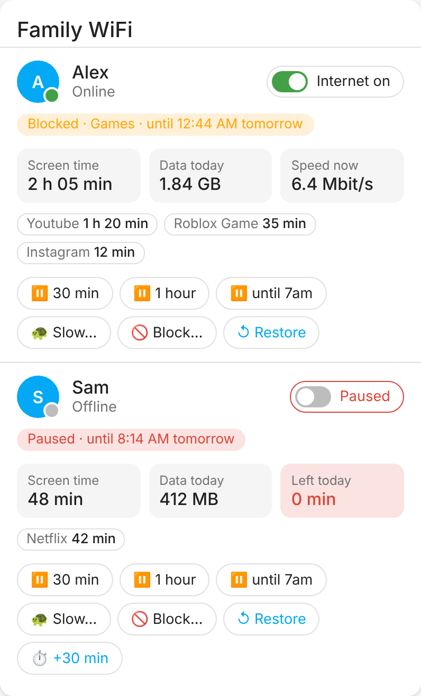
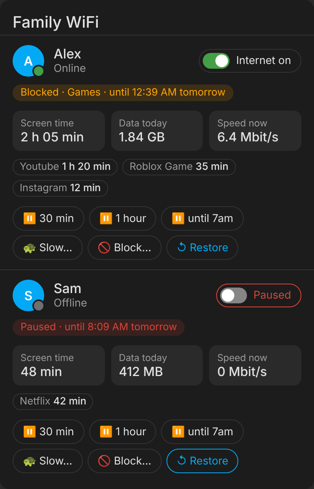
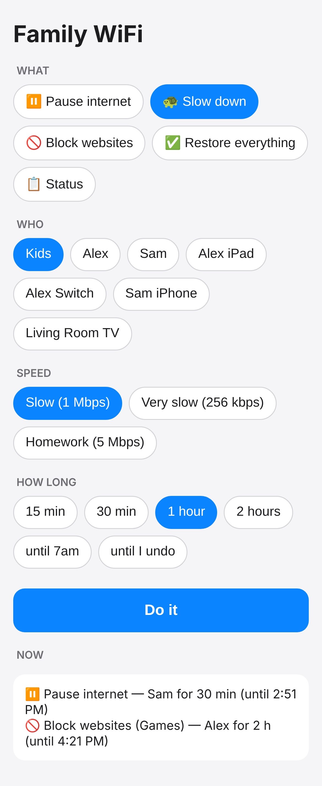

# Family WiFi

One-tap parental controls for a **UniFi** home network, run from an **iPhone Shortcut** (or Siri).

- ⏸️ **Pause internet** for a kid, a device or a group ("Kids")
- 🐢 **Slow down** their connection (1 Mbps, 256 kbps, …)
- 🚫 **Block websites**: pick a list (Games, Video, Social) or type domains
- ⏲️ **Timers** for all of the above: `15 min`, `2 hours`, `until 7am`, `until I undo`. Timers survive restarts.
- ✅ **Restore** a device or group with one tap. 📋 **Status** shows what's on and when it ends.

```
 iPhone Shortcut / Siri ──HTTPS/HTTP──▶  family-wifi (this app, on a Pi/NAS/Mac at home)
                                                │  local UniFi API
                                                ▼
                                       UniFi console (UDM / UDR / UCG / Cloud Key)
```

UniFi has no simple phone-friendly API for this, so something at home has to talk to the
console's local API. Pick one:

- **Home Assistant user?** Install the [Home Assistant integration](#home-assistant-integration).
  No extra server needed; you get switches, sensors, automations and dashboard controls.
- **No Home Assistant?** Run the small [standalone server](#2-run-the-service-at-home) and use the
  iPhone Shortcut or the built-in web page.

## How each control works in UniFi

| Control | UniFi mechanism | Notes |
|---|---|---|
| Pause | Client **block** (`cmd/stamgr block-sta`) | Works for Wi-Fi and wired. Fully offline until unblocked. |
| Slow down | **Bandwidth profile** (user group) with a speed cap; device is assigned to it and reconnected | The app creates profiles named `FamilyWiFi …`. Restore puts the device back in its previous profile. |
| Block websites | **Traffic rule** (Network 7.x+), action Block, target Domain, limited to the chosen devices | Domain blocking needs the kids' devices to use the UniFi gateway for DNS. It won't work if a device uses its own DNS, iCloud Private Relay or a VPN. |

## Home Assistant integration

Adds Family WiFi to Home Assistant (2025.8 or newer). It talks to UniFi directly.

### Install

**HACS (recommended):** HACS → ⋮ → **Custom repositories** → add `https://github.com/ak93-ak93/family-wifi`,
type **Integration** → find **Family WiFi** → Download → restart Home Assistant.

**Manual:** copy `custom_components/family_wifi` into your Home Assistant `config/custom_components/` folder
and restart.

**Updates:** each new version is published as a GitHub release. HACS picks it up and it appears in
Home Assistant under **Settings → Updates** with release notes, where you install it with one click.
Restart Home Assistant afterwards.

Then: **Settings → Devices & services → Add integration → Family WiFi**, and enter your console address plus an API key
and/or a local UniFi account (see [step 1](#1-prepare-unifi)).

### Set up kids and groups

**Settings → Devices & services → Family WiFi → Configure**:

- **Add or edit a kid or group**: give it a name ("Alex", "Kids") and pick devices from the list of
  everything UniFi has seen. Each name becomes a device in Home Assistant.
- **Website lists**: edit Games / Video / Social or add your own, one domain per line.
- **Slow-down speeds**: one per line, `Name = download/upload` in kbps.

### What you get

For each kid, group and device:

| Entity | What it does |
|---|---|
| `switch.<name>_internet` | Turn **off** to pause the internet for the kid's *For how long* choice; turn **on** to restore it |
| `switch.<name>_slow_down` | Turn **on** to limit speed to the kid's *Speed limit* choice (first preset until you pick one) |
| `select.<name>_speed_limit` | Pick a speed to slow down to now (*Slow (1 Mbps)*, *Very slow (256 kbps)*, …) or *No limit* |
| `select.<name>_for_how_long` | How long the Internet switch, Slow down switch and Speed limit apply: *15 min* … *until 7am*, *until I undo* (default). Remembered across restarts |
| `sensor.<name>_status` | `Normal`, `Paused`, `Slowed`, `Websites blocked`; attributes list each restriction and when it ends |

Plus `sensor.family_wifi_active_restrictions` (count, with a readable `summary` attribute).

### Dashboard card

The integration includes a **Family WiFi card** and loads it on every dashboard automatically, so there's
nothing to install. Edit a dashboard → **Add card** → search **Family WiFi**, or add it in YAML:

```yaml
type: custom:family-wifi-card
# all optional:
title: Family WiFi
targets: [Alex, Sam]            # default: every kid/group (devices too if you have no groups)
show_devices: false             # true = also list individual devices
pauses: ["30 min", "1 hour", "until 7am"]
```




Per kid: online dot, Internet on/off switch, active limits with end times, screen time, data today, current
speed, top apps with time, one-tap pauses, **Slow…** and **Block…** (pick a speed or website list and how long),
and **Restore**. It follows your Home Assistant theme, light or dark.

### Apple Home (and Siri)

Home Assistant's **Matter Server** add-on only works one way: it lets Home Assistant *control* Matter devices.
It can't share Home Assistant's own switches with Apple Home. Use one of these instead; they can run alongside it:

| Option | How | Notes |
|---|---|---|
| **HomeKit Bridge** (built in, simplest) | Settings → Devices & services → Add integration → **HomeKit Bridge**. Include domain `switch` and pick the `switch.*_internet` (and `*_slow_down`) entities. Scan the QR code from the notification in the Home app. | Native Apple Home, no extra add-on |
| **Home-Assistant-Matter-Hub** add-on ([RiDDiX fork](https://github.com/riddix/home-assistant-matter-hub), the maintained successor of t0bst4r's) | Install the add-on, create a bridge, filter to the Family WiFi switches (e.g. by a label), pair with the Matter QR code in the Home app | Matter, so it also works with Google Home and Alexa |
| **Matterbridge** + [matterbridge-hass](https://github.com/Luligu/matterbridge-hass) | Add-on with a long-lived token; whitelist the switches | Matter alternative |

Then in the Home app, **Alex Internet** works like a light switch: off pauses, on restores. Siri works too:
*"Hey Siri, turn off Alex Internet."*

Expose only the `Internet` and `Slow down` switches. Set *For how long* and *Speed limit* in Home Assistant
first, and the switches in Apple Home will use them. Apple Home can't show text sensors like "Top app",
and pass-through sensors just add clutter. For timed pauses from Siri, make a Home Assistant script
(e.g. `family_wifi.pause` with `target: Alex, duration: 1 hour`) and expose that too. HomeKit Bridge shows
scripts as switches.

### Usage: online, data used, top apps

For each kid, group and device, refreshed every 2 minutes:

| Entity | Shows |
|---|---|
| `binary_sensor.<name>_online` | Whether any of their devices is connected (attribute: which ones) |
| `sensor.<name>_data_used_today` | Download + upload since midnight. Kept as long-term statistics, so you get daily history graphs |
| `sensor.<name>_download_speed` / `_upload_speed` | Speed right now |
| `sensor.<name>_top_app_today` | Most-used app today, e.g. *Youtube*. Attributes `apps` (data) and `app_time` (time) for the top 10 |
| `sensor.<name>_screen_time_today` | **Estimated** time in use today, in minutes. Attributes: `app_time` (*Youtube: 1 h 05 min*), `app_minutes` (numbers, for automations), `first_active`, `last_active` |

Notes:

- **Top apps** need **Traffic Identification** turned on in UniFi (Settings → Traffic Management / Security,
  depending on version). App names come from [unpoller](https://github.com/unpoller/unifi) (MIT).
  Newer apps that list doesn't know show as e.g. *Other Media Streaming*. App counting starts from when the
  integration first sees a device, then resets at midnight.
- **Data used today** comes from UniFi's own usage reports, the same numbers as the UniFi app.
- **Screen time is an estimate.** UniFi can't see the screen, so time counts as "in use" when traffic
  stays above a level typical for real use. That level is about 0.2 Mbps for video, so background syncing
  doesn't count. Time is checked in 2-minute slices and merged across a kid's devices, so watching on two
  devices at once counts once.
  - **Undercounts:** offline or downloaded videos, reading, and single-player offline games.
  - **Overcounts:** a video left playing with nobody watching, and large downloads.
  - Treat it as a good guide, not a stopwatch.
- **Websites visited:** UniFi doesn't record which sites (domains) a device opens, so this can't show them.
  The app list is the closest UniFi gets.

**Dashboard:** [`docs/dashboard.yaml`](docs/dashboard.yaml) is a ready-made view with pause/slow-down buttons,
data today, speed, top apps, a 7-day data chart and an online timeline per kid. Paste it in the raw
configuration editor and replace `alex` with each kid's name.

### Actions (with timers)

| Action | Fields |
|---|---|
| `family_wifi.pause` | `target`, `duration` |
| `family_wifi.slow_down` | `target`, `duration`, `speed` (optional) |
| `family_wifi.block_websites` | `target`, `websites` (list name or `a.com, b.com`), `duration` |
| `family_wifi.restore` | `target`, `only` (optional: `pause` / `slow` / `sites`) |
| `family_wifi.status` | returns `{message}` |

All return `{message: "⏸️ Paused Kids for 30 min (until 8:15 PM)."}` when called with a response.
`duration` takes the same text as everywhere else: `30 min`, `2 hours`, `until 7am`, `until I undo`.

```yaml
# Weeknight bedtime
automation:
  - alias: Kids bedtime
    triggers:
      - trigger: time
        at: "21:00:00"
    conditions:
      - condition: time
        weekday: [sun, mon, tue, wed, thu]
    actions:
      - action: family_wifi.pause
        data: {target: Kids, duration: until 7am}

# Daily YouTube limit: after 60 minutes, block video sites until tomorrow and tell me
  - alias: Alex YouTube limit
    triggers:
      - trigger: template
        value_template: >-
          {{ (state_attr('sensor.alex_screen_time_today', 'app_minutes') or {}).get('Youtube', 0) >= 60 }}
    actions:
      - action: family_wifi.block_websites
        data: {target: Alex, websites: Video, duration: until 7am}
      - action: notify.notify
        data:
          message: "Alex reached 1 hour of YouTube today, so video sites are blocked until 7am."

# A script you can run from the dashboard, Siri or an iPhone Shortcut
script:
  kids_homework_mode:
    alias: Homework mode
    sequence:
      - action: family_wifi.block_websites
        data: {target: Kids, websites: Games, duration: 2 hours}
      - action: family_wifi.slow_down
        data: {target: Kids, speed: "Homework (5 Mbps)", duration: 2 hours}
```

**From your iPhone:** the Home Assistant Companion app adds Shortcuts actions, including running a script or
performing an action. Siri can run them, and they work away from home through Home Assistant's remote access,
with no VPN needed. Dashboard tiles for the `Internet` switches give you one-tap pause and resume.

## 1. Prepare UniFi

1. **Give the app access.** Use an **API key**, a **local account**, or both:
   - **API key** (UniFi Network 9 or newer): **UniFi Network → Settings → Control Plane → Integrations →
     Create API Key**. Copy it straight into `config.yaml` (or the Home Assistant setup screen). Don't paste it
     into chats or emails.
   - **Local account**: in UniFi OS, **Admins & Users → Add Admin**: name `family-wifi`, **Restrict to local
     access only**, role **Site Admin** for Network. Local accounts don't need 2FA, which this app can't do.
   - **Both (recommended):** UniFi's API keys are new, and on some versions they only work for part of the
     API this app uses. With both set, the key is used first and the account takes over automatically if
     UniFi refuses the key. Run the [check](#test-your-setup) to see which one your console uses.
2. On each kid's iPhone/iPad: **Settings → Wi-Fi → (i) on your network → Private Wi-Fi Address: Off**
   (or set it to *Fixed*). Otherwise the device's MAC address changes and the rules stop applying to it.
3. Write down each device's MAC address from **UniFi Network → Client Devices**.

## 2. Run the service at home

You need something that's always on at home: a Raspberry Pi, NAS, Mac mini, or any Docker host.

```bash
git clone https://github.com/ak93-ak93/family-wifi.git
cd family-wifi
mkdir -p data
cp config.example.yaml data/config.yaml
nano data/config.yaml            # UniFi login, api_token, devices, groups, site lists
docker compose up -d --build
```

Without Docker (Python 3.11+):

```bash
pip install -r requirements.txt
cp config.example.yaml config.yaml && nano config.yaml
python -m family_wifi            # listens on port 8787
```



Check it: open `http://<server-ip>:8787` on your phone, paste your `api_token`, and you get a
simple control page. Add it to your Home Screen with **Share → Add to Home Screen** for an app-like icon.

> 💡 Give the server a fixed IP (UniFi: Client Devices → the server → Settings → Fixed IP Address).

## Test your setup

After filling in `config.yaml`, run the check. It only reads from UniFi, except for one harmless test that
blocks and unblocks a made-up device that isn't on your network:

```bash
python -m family_wifi.check
# Docker:
docker compose run --rm family-wifi python -m family_wifi.check
```

```
Console: https://192.168.1.1   site: default
Auth:    API key + username/password fallback

✅ Reach the console: UniFi OS
✅ Sign in: api key
✅ Read clients (needed for everything): 23 online, 61 known
✅ Read bandwidth profiles (needed for Slow down): Default
✅ Read traffic rules (needed for Block websites): 2 rules
✅ Permission to block devices (needed for Pause): allowed (tested with a made-up device)

All good.
```

The output above is an illustration, not from a real console.

Add `--usage` to also see who's online, data used today and top apps (checks the Home Assistant usage sensors
will work).

Then try a real pause on one device. It pauses for 60 seconds and restores it, even if you press Ctrl-C:

```bash
python -m family_wifi.check --try-pause "Alex iPad"
```

What the results mean:

- **Sign in** says *login* although you set a key: UniFi refused the key for some calls and the app switched to
  your username/password. Everything still works.
- **"didn't accept the API key"**: your UniFi version doesn't allow keys for that part of the API. Add a
  username/password.
- **"UniFi has never seen …"**: wrong MAC address, or the device uses a Private Wi-Fi Address.
- `--show-rules` prints your existing traffic rules. If you've made a domain block in the UniFi app,
  this shows the exact format your console uses.

Home Assistant: the setup screen runs the same sign-in check. Then flip one device's **Internet** switch off and on.

## 3. Build the iPhone Shortcut (about 5 minutes, once)

The Shortcut downloads its menus (your kids, devices, speeds, site lists) from the server.
**After you edit `config.yaml` you don't need to change the Shortcut.**

Open **Shortcuts → +** and add these actions in order. Replace `SERVER` with e.g. `http://192.168.1.20:8787`
and `TOKEN` with your `api_token`.

1. **Get Contents of URL** → `SERVER/menu`
   - Show More → Method **GET** → Headers: `Authorization` = `Bearer TOKEN`
2. **Get Dictionary Value** → `actions` from *Contents of URL* → **Choose from List** (prompt "What?")
   → **Set Variable** `Action`
3. **Get Dictionary Value** → `targets` from *Contents of URL* → **Choose from List** (prompt "Who?")
   → **Set Variable** `Target`
4. **Text** (empty) → **Set Variable** `Option`
5. **If** `Action` *contains* `Slow`:
   - **Get Dictionary Value** `speeds` from *Contents of URL* → **Choose from List** → **Set Variable** `Option`
6. **If** `Action` *contains* `websites`:
   - **Get Dictionary Value** `site_lists` from *Contents of URL* → **Choose from List** → **Set Variable** `Option`
7. **Text** `until I undo` → **Set Variable** `Duration`
8. **If** `Action` *does not contain* `Restore`:
   - **Get Dictionary Value** `durations` from *Contents of URL* → **Choose from List** (prompt "How long?")
     → **Set Variable** `Duration`
9. **Get Contents of URL** → `SERVER/do`
   - Method **POST**, Headers: `Authorization` = `Bearer TOKEN`
   - Request Body **JSON**: `action` = `Action`, `target` = `Target`, `option` = `Option`, `duration` = `Duration`
10. **Get Dictionary Value** `message` from *Contents of URL* → **Show Result**

Name it **Family WiFi**. Now "Hey Siri, Family WiFi" works, and you can add it to your Home Screen
or a widget. *Status* ignores the "Who?" choice.

### Optional: one-tap shortcuts

For things you do every day, make a tiny shortcut with just step 9 and fixed values, e.g. **"Kids bedtime"**:

```json
{"action": "pause", "target": "Kids", "duration": "until 7am"}
```

Other examples:

```json
{"action": "slow",    "target": "Alex", "option": "Slow (1 Mbps)", "duration": "1 hour"}
{"action": "sites",   "target": "Sam",  "option": "Games",         "duration": "until 9pm"}
{"action": "sites",   "target": "Kids", "option": "youtube.com, tiktok.com", "duration": "2 hours"}
{"action": "restore", "target": "Kids"}
{"action": "status"}
```

Combine these with **Shortcuts → Automation → Time of Day** for schedules, e.g. a weekday 9 pm bedtime
pause. Turn off "Ask Before Running".

## Using it away from home

The server is only on your home network. To use it on cellular, use the **UniFi Teleport / WireGuard VPN**
(built into UniFi consoles) or Tailscale on the phone. Don't port-forward this service to the internet.

## API

All endpoints except `/` and `/health` need `Authorization: Bearer <api_token>`.

| Method | Path | Body / result |
|---|---|---|
| GET | `/menu` | `{actions, targets, durations, speeds, site_lists}` for building pick lists |
| POST | `/do` | `{action, target, duration?, option?}` → `{ok, message}` |
| GET | `/status` | `{ok, message}` listing active restrictions and end times |

- `action`: `pause` · `slow` · `sites` · `restore` · `status` (menu labels like "⏸️ Pause internet" also work)
- `target`: any group or device name from config (not case sensitive)
- `duration`: `30`, `30 min`, `1.5 hours`, `1 hour 30 min`, `until 7am`, `9:30 pm`, `tomorrow morning`, `until I undo`
- `option`: speed preset for `slow`; site list name or comma-separated domains for `sites`;
  optionally `pause`/`slow`/`sites` for `restore` to undo only that kind

Rules: a new pause or slow-down on a device replaces the earlier one (the new timer wins).
Website blocks stack. Timers are checked every 15 seconds and caught up on startup.

## Development

```bash
pip install -r requirements.txt pytest pytest-homeassistant-custom-component
python -m pytest
```

Tests run against a fake UniFi console (`tests/fake_unifi.py`), so no hardware is needed.
`tests/ha/` tests the Home Assistant integration and is skipped if its test package isn't installed.

The UniFi logic lives in `family_wifi/` and is copied into `custom_components/family_wifi/core/`
(Home Assistant integrations must be self-contained). After changing it, run `python scripts/sync_core.py`;
a test fails if the copies differ.

**Releasing:** bump `version` in `custom_components/family_wifi/manifest.json` and merge to `main`.
The Release workflow publishes `v<version>` automatically.

## Compatibility notes

- Tested against a simulated UniFi OS console only. The API paths match the ones used by the
  `aiounifi` library (used by Home Assistant). The first time you use it on your network, try each action
  on one device and check UniFi to see it applied.
- Bandwidth profiles: if your Network version doesn't support them, *Slow down* returns
  an error from UniFi and the other features keep working.
- Standalone Network app (not a UniFi OS console) is detected automatically. Set `url` to `https://host:8443`.
