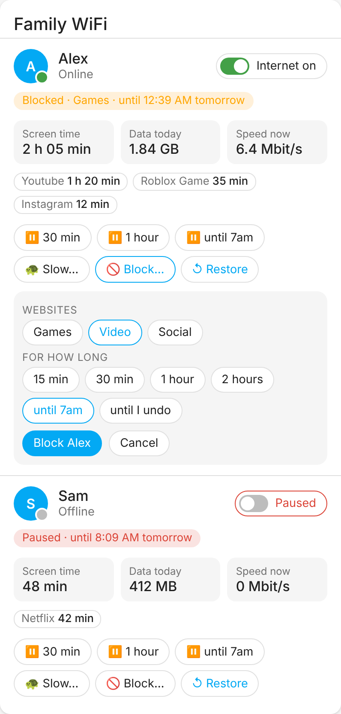
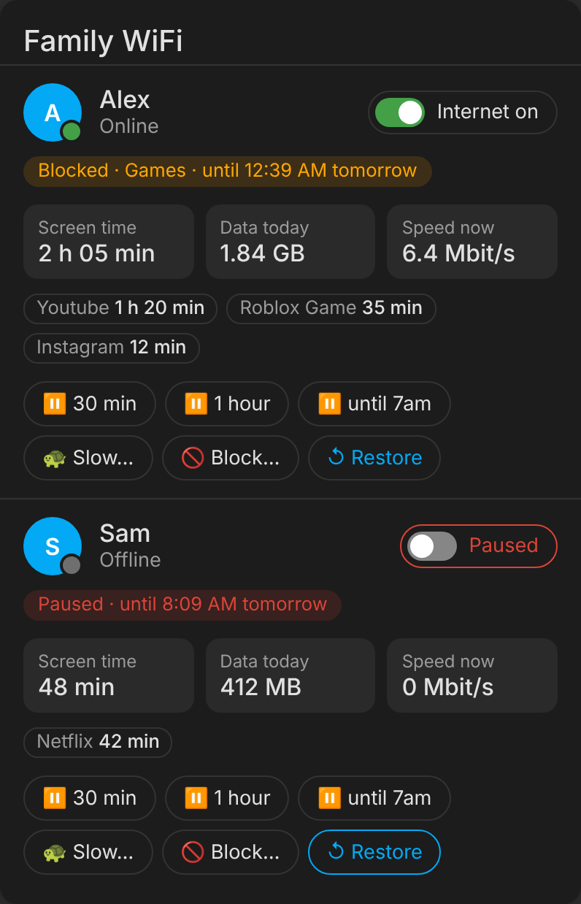

# Family WiFi reference

Everything the integration adds to Home Assistant, with examples. See the [README](../README.md) for setup.

- [Entities](#entities)
- [Actions](#actions)
- [Events](#events)
- [Dashboard card](#dashboard-card)
- [Examples](#examples)
- [Apple Home and Siri](#apple-home-and-siri)
- [How it works in UniFi](#how-it-works-in-unifi)

## Entities

Each kid, group and device you set up becomes a Home Assistant device with these entities.
`<name>` is the name in lower case with spaces as `_` (e.g. "Alex iPad" → `alex_ipad`).

### Controls

| Entity | What it does |
|---|---|
| `switch.<name>_internet` | **Off** pauses the internet for the *For how long* choice. **On** restores it |
| `switch.<name>_slow_down` | **On** slows down to the *Speed limit* choice (first speed until you pick one) |
| `select.<name>_speed_limit` | Slow down to a speed right now, or *No limit* to remove the slow-down |
| `select.<name>_for_how_long` | How long the two switches and Speed limit apply: *15 min*, *30 min*, *1 hour*, *2 hours*, *until 7am*, *until I undo* (default). Remembered across restarts. Configuration entity |

### Status and usage

| Entity | Shows |
|---|---|
| `sensor.<name>_status` | `Normal`, `Paused`, `Slowed`, `Websites blocked`, or a combination. Attribute `restrictions` lists each one with `ends_at` |
| `binary_sensor.<name>_online` | Whether any of their devices is connected. Attribute `devices_online` |
| `sensor.<name>_data_used_today` | Download + upload since midnight, from UniFi's usage reports. Has long-term statistics |
| `sensor.<name>_download_speed` | Speed right now. Per-device ones start disabled when you have groups |
| `sensor.<name>_upload_speed` | Speed right now. Starts disabled |
| `sensor.<name>_top_app_today` | Most-used app today. Attributes `apps` (data) and `app_time` (time), top 10 |
| `sensor.<name>_screen_time_today` | Estimated minutes in use today. Attributes `app_time`, `app_minutes` (numbers, for automations), `first_active`, `last_active` |
| `sensor.family_wifi_active_restrictions` | Number of active restrictions in the house. Attribute `summary` |

Usage refreshes every 2 minutes. Top apps need UniFi's **Traffic Identification**.

### Daily limits (kids and groups only)

| Entity | What it does |
|---|---|
| `number.<kid>_daily_screen_time` | Minutes per day, 0 = no limit. Configuration entity |
| `sensor.<kid>_screen_time_left` | Minutes left today (unknown with no limit). Attributes `used_today`, `daily_limit`, `extra_today`, `when_reached`, `apps_left` |
| `button.<kid>_30_min` | **+30 min** for today on every limit, and lifts any limit that already kicked in |

What happens when time runs out (pause or slow down) and the per-app limits are set under
**Family WiFi → Configure → Daily limits**. Limits reset at midnight.

## Actions

All of them return `{message: "..."}` when called with a response, e.g. *"⏸️ Paused Kids for 30 min (until 8:15 PM)."*

| Action | Fields |
|---|---|
| `family_wifi.pause` | `target`, `duration` |
| `family_wifi.slow_down` | `target`, `duration`, `speed` (optional, default the first speed) |
| `family_wifi.block_websites` | `target`, `websites` (a list name, or domains like `youtube.com, tiktok.com`), `duration` |
| `family_wifi.restore` | `target`, `only` (optional: `pause`, `slow` or `sites`; empty undoes everything) |
| `family_wifi.extra_time` | `target`, `minutes` (default 30) |
| `family_wifi.status` | none |

- **`target`**: any kid, group or device name, not case sensitive.
- **`duration`**: `15 min`, `30`, `1.5 hours`, `1 hour 30 min`, `until 7am`, `9:30 pm`, `tomorrow morning`,
  or `until I undo` (the default).

**Overlaps:**
- A new pause or slow-down on a device replaces the earlier one: the new timer wins.
- Website blocks add up.
- `extra_time` only lifts restrictions that a daily limit set, never ones you set yourself.

## Events

| Event | When | Data |
|---|---|---|
| `family_wifi_limit_warning` | 10 minutes of screen time left | `target`, `limit`, `minutes_left` |
| `family_wifi_limit_reached` | A screen-time or app limit is used up | `target`, `limit` (`screen_time` or `app`), `app`, `minutes`, `message` |

A Home Assistant notification is also shown when a limit is reached.

## Dashboard card

The integration loads the card on every dashboard; add it with **Add card → Family WiFi**, or in YAML:

```yaml
type: custom:family-wifi-card
title: Family WiFi                    # optional
targets: [Alex, Sam]                  # optional, default every kid/group (devices too if you have no groups)
show_devices: false                   # optional, true lists individual devices as well
pauses: ["30 min", "1 hour", "until 7am"]   # optional, the quick-pause buttons
```




If you'd rather build your own, [`dashboard.yaml`](dashboard.yaml) is a dashboard view made from standard
cards, with a 7-day screen-time chart.

## Examples

### Bedtime with the Schedule helper

Create **Settings → Devices & services → Helpers → Create helper → Schedule**, e.g. "Kids bedtime" with school
nights 21:00–07:00. Then:

```yaml
automation:
  - alias: Kids bedtime
    triggers:
      - trigger: state
        entity_id: schedule.kids_bedtime
    actions:
      - if: "{{ trigger.to_state.state == 'on' }}"
        then:
          - action: family_wifi.pause
            data: {target: Kids, duration: until I undo}
        else:
          - action: family_wifi.restore
            data: {target: Kids, only: pause}
```

### Notify your phone

```yaml
automation:
  - alias: Family WiFi limits
    triggers:
      - trigger: event
        event_type: family_wifi_limit_warning
        id: warning
      - trigger: event
        event_type: family_wifi_limit_reached
        id: reached
    actions:
      - action: notify.mobile_app_your_phone
        data:
          message: >-
            {{ trigger.event.data.target }} has
            {{ trigger.event.data.minutes_left }} minutes of screen time left.
            {{ trigger.event.data.message }}
```

### Homework mode

A script you can put on a dashboard, or run from Siri through the Home Assistant app:

```yaml
script:
  homework_mode:
    alias: Homework mode
    sequence:
      - action: family_wifi.block_websites
        data: {target: Kids, websites: Games, duration: 2 hours}
      - action: family_wifi.slow_down
        data: {target: Kids, speed: "Homework (5 Mbps)", duration: 2 hours}
```

## Apple Home and Siri

Home Assistant's **Matter Server** add-on only lets Home Assistant *control* Matter devices. It can't share Home
Assistant's switches with Apple Home. Use one of these alongside it:

| Option | Setup |
|---|---|
| **HomeKit Bridge** (built in, simplest) | Add the **HomeKit Bridge** integration, include only the `switch.*_internet` and `switch.*_slow_down` entities, then scan the QR code from the notification in the Home app |
| **Home-Assistant-Matter-Hub** add-on ([RiDDiX fork](https://github.com/riddix/home-assistant-matter-hub), the maintained one) | Create a bridge filtered to those switches (e.g. by label) and pair it in the Home app. Being Matter, it also works with Google Home and Alexa |
| **Matterbridge** + [matterbridge-hass](https://github.com/Luligu/matterbridge-hass) | Another Matter option; whitelist the switches |

**What you get in the Home app:**
- **Alex Internet** works like a light switch, so *"Hey Siri, turn off Alex Internet"* pauses Alex.
- The pause lasts for Alex's *For how long* choice in Home Assistant.
- The slow-down uses their *Speed limit* choice.

**Only expose the switches.** Apple Home can't show text sensors like *Top app*. For a fixed "Pause Alex for 1
hour", expose a Home Assistant script instead; HomeKit Bridge shows scripts as switches.

## How it works in UniFi

| Control | UniFi feature | Notes |
|---|---|---|
| Pause | Client block | Wi-Fi and wired. The device is fully offline until restored |
| Slow down | Bandwidth profile (user group) | The integration creates profiles named `FamilyWiFi <speed>`. Restore puts the device back in its previous profile |
| Block websites | Traffic rule: Block, Domain, limited to the chosen devices | Needs the devices to use the UniFi gateway for DNS. A VPN, iCloud Private Relay or custom DNS gets around it |
| Online, speed | Live client list | |
| Data used today | Hourly and 5-minute usage reports | |
| Top apps, screen time | Traffic Identification (DPI) counters | Time is estimated from traffic, in 2-minute slices |

**Sign-in:** the integration signs in with your API key, or the local account if UniFi refuses the key. It
works with UniFi OS consoles (UDM, UDR, UCG, Cloud Key Gen2+) and the standalone UniFi Network application
(`https://host:8443`).

**Saved data:** active timers, usage counters and today's limits are saved in Home Assistant's `.storage`
folder, so they survive restarts and are included in backups. Removing the integration deletes them.
